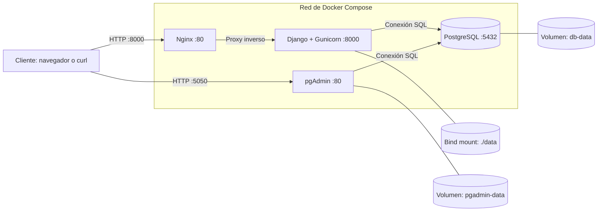

# AE4 — Aplicación Web con Base de Datos en Contenedores (UT4)

- **Alumno:** Marcos Rodríguez Hernández
- **Módulo:** Despliegue de Aplicaciones Web (DPL) — UT4
- **Repositorio remoto:** `https://github.com/Mrcs-2244/ae4-Aplicacion.git`

---

## 1. Descripción y arquitectura del despliegue

Este proyecto despliega una aplicación web multicontenedor mediante Docker Compose. Está compuesto por cuatro servicios conectados a través de una red interna de Docker.

1. **Nginx (`nginx:1.27-alpine`):** servidor web frontal y punto de entrada a la aplicación mediante `http://localhost:8000`. Actúa como proxy inverso hacia la aplicación.
2. **Aplicación (`app`):** ejecuta Django mediante Gunicorn y utiliza PostgreSQL para gestionar los datos. Escucha en el puerto interno `8000`.
3. **Base de datos (`db`):** utiliza PostgreSQL 16 Alpine en el puerto interno `5432`. Inicializa la tabla `places` mediante `db/init.sql` y almacena los datos en el volumen `db-data`.
4. **Administración (`pgadmin`):** permite administrar PostgreSQL desde `http://localhost:5050`. Utiliza el volumen `pgadmin-data` para persistir su configuración.

La aplicación también utiliza el directorio local `data/` para almacenar el contador de visitas, según la configuración del proyecto.

### Diagrama de arquitectura



### Puertos documentados

| Servicio | Puerto del anfitrión | Puerto del contenedor | Acceso |
|---|---:|---:|---|
| Nginx | 8000 | 80 | `http://localhost:8000` |
| pgAdmin | 5050 | 80 | `http://localhost:5050` |
| Aplicación | No publicado | 8000 | Red interna |
| PostgreSQL | No publicado | 5432 | Red interna |

## 2. Proceso de despliegue paso a paso

### Paso 1. Estructura y configuración

Se organizó el proyecto en directorios para la aplicación, la base de datos y la configuración de Nginx. El archivo `compose.yml` define los cuatro servicios, sus redes, volúmenes, puertos y comprobaciones de salud.

### Paso 2. Construcción y arranque

El despliegue se realiza mediante el script `deploy.sh`, que automatiza la construcción y el arranque de los contenedores.

```bash
chmod +x deploy.sh
./deploy.sh
```

### Paso 3. Comprobación de los contenedores

Se comprueba que los servicios están activos y saludables:

```bash
docker compose ps
```

### Paso 4. Comprobación de la aplicación

Se comprueba la página principal y el endpoint de salud:

```bash
curl -i http://localhost:8000/
curl -sf http://localhost:8000/healthz
```

La aplicación responde correctamente y el endpoint de salud devuelve una respuesta HTTP satisfactoria.

### Paso 5. Comprobación de la base de datos y la API

Se consulta el número de registros de la tabla `places` y se comprueba la API:

```bash
docker compose exec -T db psql -U alumno -d travelroad -c "SELECT count(*) FROM places;"
curl -sf http://localhost:8000/api/lugares
```

Las pruebas realizadas muestran 11 registros en la tabla y una respuesta correcta de la API con los lugares disponibles.

### Paso 6. Administración mediante pgAdmin

Se accede a pgAdmin desde:

`http://localhost:5050`

Para conectar con PostgreSQL desde pgAdmin, se utiliza el nombre del servicio `db` como host y el puerto interno `5432`.

También se puede comprobar el endpoint de disponibilidad de pgAdmin:

```bash
curl -sf http://localhost:5050/misc/ping
```

## 3. Persistencia de datos

El proyecto utiliza mecanismos de persistencia diferenciados:

- **Aplicación:** directorio local `data/`, montado en el contenedor según la configuración de Docker Compose.
- **PostgreSQL:** volumen con nombre `db-data`.
- **pgAdmin:** volumen con nombre `pgadmin-data`.

Estos mecanismos permiten conservar los datos y la configuración correspondientes aunque se detengan o recreen los contenedores.

## 4. Seguridad y disponibilidad

La configuración utiliza una red interna de Docker Compose para la comunicación entre los servicios. Los puertos de PostgreSQL y de la aplicación no se publican directamente en el anfitrión; el acceso web se realiza mediante Nginx y pgAdmin.

Las credenciales se configuran mediante variables de entorno. Los servicios incorporan comprobaciones de salud y políticas de reinicio según lo definido en `compose.yml`.

## 5. Resultado final

Se ha comprobado que los cuatro contenedores están activos y saludables, que la aplicación web responde correctamente, que el endpoint `/healthz` funciona y que la base de datos contiene 11 registros en la tabla `places`. La API devuelve los lugares almacenados y pgAdmin está disponible para la administración de la base de datos.
